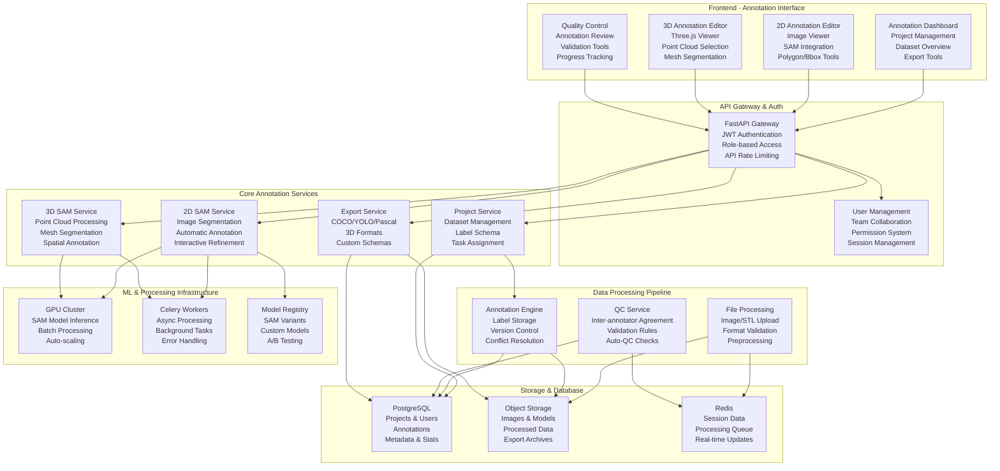

Excellent direction! Turning this into a comprehensive **annotation tool** makes perfect sense since SAM is fundamentally designed for annotation tasks. This will create a powerful platform for both 2D and 3D data labeling. Let me update the architecture and plan.
Ran tool

## Updated Project Vision: SAM-Powered Annotation Platform

Your tool will become a **comprehensive annotation platform** that leverages SAM for both 2D images and 3D models - perfect for creating training datasets for computer vision and 3D ML models.

### Enhanced Architecture


## Comprehensive Annotation Platform Features

### **Core Annotation Capabilities**

#### **2D Image Annotation (New)**
- **SAM-Powered Segmentation**: Click-to-segment with automatic mask generation
- **Interactive Refinement**: Add/remove points to refine SAM predictions
- **Multiple Annotation Types**:
  - Instance segmentation masks
  - Bounding boxes with auto-generation from masks
  - Polygons and keypoints
  - Classification labels
- **Batch Processing**: Process entire image datasets automatically
- **Smart Annotation**: SAM can suggest annotations based on similar objects

#### **3D Model Annotation (Enhanced)**
- **Point Cloud Labeling**: Your existing 3D segmentation enhanced with label management
- **Mesh Annotation**: Segment and label 3D mesh regions
- **Spatial Relationships**: Annotate object relationships in 3D space
- **Multi-view Annotation**: Annotate from different camera angles
- **Volumetric Segmentation**: Full 3D volume labeling

### **Enhanced Backend Services**

#### **1. Project Management Service**
```python
# Comprehensive dataset and project management
- POST /api/projects - Create annotation projects
- GET /api/projects/{id}/datasets - Manage datasets
- POST /api/projects/{id}/labels - Define label schemas
- GET /api/projects/{id}/stats - Progress analytics
- POST /api/projects/{id}/assignments - Task assignment
```

#### **2. Dual SAM Services**

**2D SAM Service:**
```python
# Handles all 2D image annotation tasks
- POST /api/2d/segment - Interactive segmentation
- POST /api/2d/batch-segment - Batch processing
- GET /api/2d/suggestions - Smart annotation suggestions
- POST /api/2d/refine - Interactive refinement
- GET /api/2d/auto-label - Automatic labeling
```

**3D SAM Service (Enhanced):**
```python
# Your existing 3D capabilities plus enhancements
- POST /api/3d/point-select - Point cloud selection
- POST /api/3d/mesh-segment - Mesh segmentation  
- POST /api/3d/spatial-annotate - 3D spatial annotation
- GET /api/3d/multi-view - Multi-angle annotation
```

#### **3. Export & Integration Service**
```python
# Support for all major ML training formats
- GET /api/export/coco - COCO JSON format
- GET /api/export/yolo - YOLO format
- GET /api/export/pascal - Pascal VOC
- GET /api/export/custom - Custom format
- GET /api/export/3d-datasets - PLY, OBJ, custom 3D formats
```

### **Advanced Frontend Components**

#### **2D Annotation Interface**
```javascript
// Modern image annotation editor
components/
├── ImageViewer/           // Canvas-based image display
├── SAMIntegration/        // Real-time segmentation
├── AnnotationTools/       // Bbox, polygon, keypoint tools
├── LabelManager/          // Label schema management
└── BatchProcessor/        // Bulk annotation workflows
```

#### **3D Annotation Interface** 
```javascript
// Enhanced version of your current VTK setup
components/
├── ThreeJSViewer/         // Replaces VTK with Three.js
├── PointCloudTools/       // Enhanced point selection
├── MeshSegmentation/      // Interactive 3D segmentation
├── SpatialAnnotation/     // 3D relationship annotation
└── MultiViewManager/      // Multiple camera angles
```

#### **Unified Dashboard**
```javascript
// Project management and analytics
components/
├── ProjectDashboard/      // Overview and metrics
├── DatasetManager/        // File organization
├── TeamCollaboration/     // User management
├── QualityControl/        // Review and validation
└── ExportCenter/          // Format conversion
```

### **Enhanced Data Models**

#### **Project Structure**
```sql
-- Core project management
Projects (id, name, description, owner_id, created_at)
Datasets (id, project_id, name, type, file_count)
Labels (id, project_id, name, color, type)
Tasks (id, dataset_id, assignee_id, status, priority)
```

#### **Annotation Storage**
```sql
-- Flexible annotation system
Annotations (id, task_id, annotator_id, type, data, confidence)
AnnotationHistory (id, annotation_id, version, changes, timestamp)
QualityReviews (id, annotation_id, reviewer_id, status, feedback)
```

### **Advanced Features**

#### **1. Smart Annotation Workflows**
- **Auto-propagation**: Apply annotations across similar images/models
- **Active Learning**: Suggest next best items to annotate
- **Consensus Building**: Merge annotations from multiple annotators
- **Quality Metrics**: Inter-annotator agreement calculations

#### **2. Collaboration Features**
- **Role-based Access**: Admin, Annotator, Reviewer permissions
- **Task Assignment**: Distribute work across team members
- **Real-time Collaboration**: Multiple users on same project
- **Progress Tracking**: Individual and team productivity metrics

#### **3. Integration Capabilities**
- **API Access**: RESTful API for external integrations
- **Webhook Support**: Real-time notifications to external systems
- **Model Training Integration**: Direct export to training pipelines
- **Version Control**: Git-like versioning for annotation datasets

### **Implementation Roadmap**

#### **Phase 1: Core Platform (Weeks 1-3)**
- Set up FastAPI backend with authentication
- Build basic project and dataset management
- Create user interface foundation
- Implement file upload and basic storage

#### **Phase 2: 2D Annotation System (Weeks 4-6)**
- Integrate SAM for 2D image segmentation
- Build interactive annotation interface
- Add support for multiple annotation types
- Implement batch processing capabilities

#### **Phase 3: Enhanced 3D System (Weeks 7-8)**
- Migrate existing 3D code to web services
- Replace VTK with Three.js frontend
- Add advanced 3D annotation features
- Implement multi-view annotation

#### **Phase 4: Advanced Features (Weeks 9-10)**
- Add collaboration and team management
- Implement quality control workflows  
- Build comprehensive export system
- Add analytics and reporting

#### **Phase 5: Optimization & Deployment (Weeks 11-12)**
- Performance optimization and scaling
- Production deployment setup
- Documentation and user training
- Beta testing and feedback integration

### **Technical Advantages**

#### **Unified SAM Platform**
- **Single Model**: SAM handles both 2D and 3D annotation tasks
- **Consistent UX**: Similar interaction patterns across dimensions
- **Shared Infrastructure**: Common GPU resources and processing

#### **Modern Web Architecture**
- **Scalable**: Handle large teams and massive datasets
- **Accessible**: No installation, works on any device
- **Collaborative**: Real-time multi-user annotation
- **Maintainable**: Microservices architecture

This comprehensive annotation platform will serve researchers, companies, and teams who need to create high-quality labeled datasets for both 2D computer vision and 3D machine learning models!
